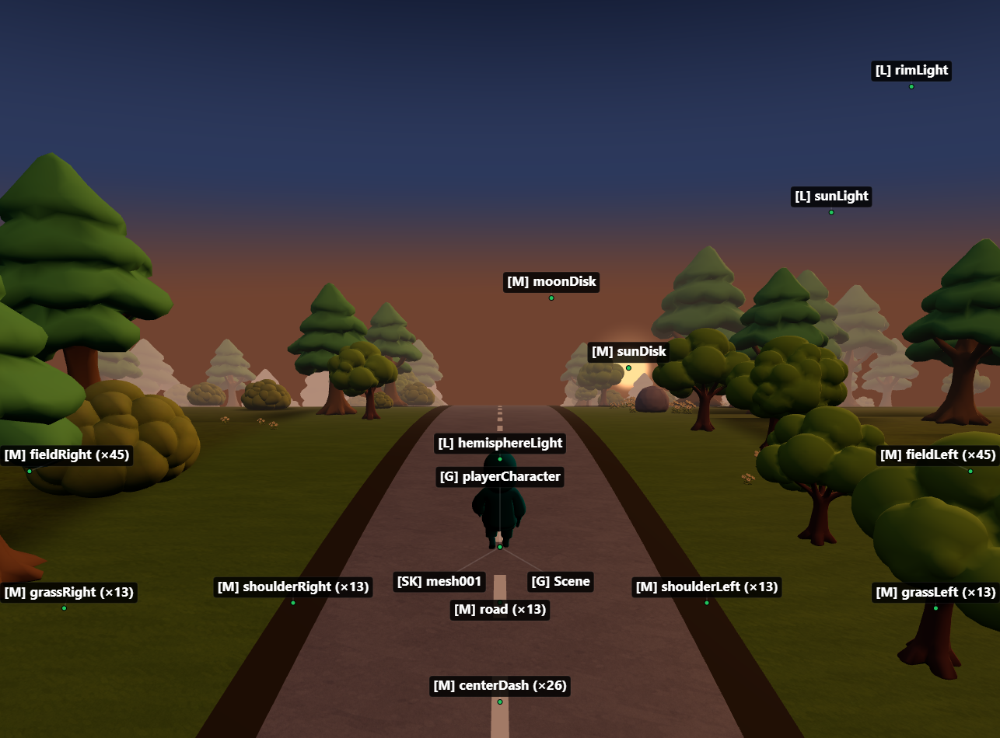
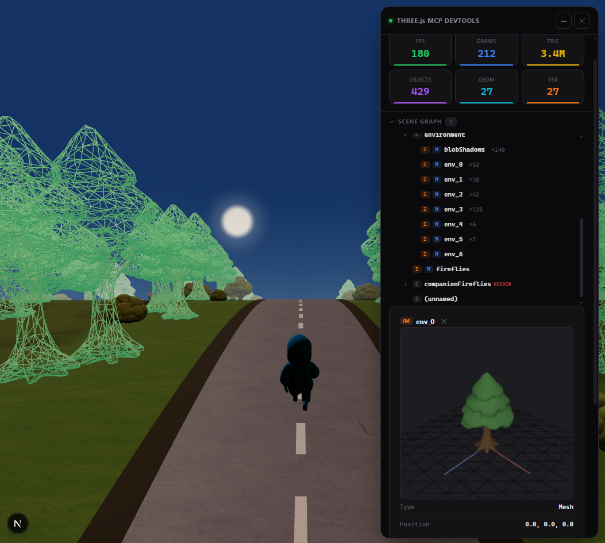

# threejs-devtools-mcp

[](https://www.npmjs.com/package/threejs-devtools-mcp)
[](LICENSE)
[](https://github.com/DmitriyGolub/threejs-devtools-mcp/actions)
[](https://mcp-marketplace.io/server/io-github-dmitriygolub-threejs-devtools)

MCP server for inspecting Three.js scenes in real time, trying changes live in the browser, and turning them into code. **69 tools** cover objects, materials, shaders, textures, animation, performance and memory, plus website audits, video frame capture and Playwright helpers.

**Zero changes to your project.** Works with vanilla Three.js and React Three Fiber, on WebGLRenderer and WebGPURenderer.



## Setup

### 1. Add the MCP server

<details open>
<summary><strong>Claude Code</strong></summary>

```bash
claude mcp add threejs-devtools-mcp -- npx threejs-devtools-mcp
```

</details>

<details>
<summary><strong>Claude Desktop</strong></summary>

Add to `claude_desktop_config.json`:

```json
{
  "mcpServers": {
    "threejs-devtools-mcp": {
      "command": "npx",
      "args": ["-y", "threejs-devtools-mcp"]
    }
  }
}
```

</details>

<details>
<summary><strong>Cursor</strong></summary>

Add to `.cursor/mcp.json` in your project:

```json
{
  "mcpServers": {
    "threejs-devtools-mcp": {
      "command": "npx",
      "args": ["-y", "threejs-devtools-mcp"]
    }
  }
}
```

Or use the HTTP transport — see [Cursor setup guide](docs/cursor-setup.md).

</details>

<details>
<summary><strong>Windsurf</strong></summary>

Add to `~/.codeium/windsurf/mcp_config.json`:

```json
{
  "mcpServers": {
    "threejs-devtools-mcp": {
      "command": "npx",
      "args": ["-y", "threejs-devtools-mcp"]
    }
  }
}
```

</details>

<details>
<summary><strong>VS Code (Copilot)</strong></summary>

Add to `.vscode/mcp.json`:

```json
{
  "servers": {
    "threejs-devtools-mcp": {
      "command": "npx",
      "args": ["-y", "threejs-devtools-mcp"]
    }
  }
}
```

</details>

<details>
<summary><strong>OpenCode</strong></summary>

Add to `opencode.json` in your project:

```json
{
  "$schema": "https://opencode.ai/config.json",
  "mcp": {
    "threejs-devtools-mcp": {
      "type": "local",
      "command": ["npx", "-y", "threejs-devtools-mcp"],
      "enabled": true
    }
  }
}
```

</details>

### 2. Start your dev server and open the browser

Start your Three.js dev server as usual (`npm run dev`). The MCP server auto-detects the port from `package.json` and opens a browser at `localhost:9222` with the devtools bridge injected.

> **Keep the browser tab open.** The MCP server talks to your scene through a WebSocket bridge. Close the tab = tools stop working.

### 3. Ask the AI about your scene

```
"show me the scene tree"
"why is my model invisible?"
"try the car in red"          ← live preview, nothing saved
"keep it"                     ← written into your code
"audit this site for mobile"
"record a 5-second clip at 60 fps"
```

## Look now vs. change the code

Every tool is labelled, so you and the AI always know what touches your files:

| | Tools | Your code |
|---|---|---|
| **Inspect** | `scene_tree`, `material_details`, `web_audit`, screenshots… | untouched |
| **Live preview** | `set_material_property`, `set_light`, `set_camera`… | untouched; lost on page reload |
| **Debug visual** | wireframe, bounding boxes, helpers, overlay | untouched; never needed in code |
| **For code** | `pending_changes`, `gltf_to_r3f` | the AI writes this into your source |

Every live-preview change is recorded. `pending_changes` returns each one as **before → after with ready-to-paste code** (vanilla Three.js and React Three Fiber) and where to find it in your project. `revert_changes` undoes them in the browser.

## For websites and videos

- **`web_audit`**: checks for a blurry canvas (pixel ratio, missing resize), battery drain (rendering while idle or off-screen), heavy textures (oversized, not KTX2), expensive shadows, wrong color space and too many draw calls. Each finding comes with the fix.
- **`capture_frames`**: records a frame sequence for promo clips and reels. Time is virtualised, so the output is perfectly smooth at 30/60 fps even if your scene renders slowly. You get the `ffmpeg` command for MP4/WebM.

## Skills

Ready-made workflows show up as slash commands in Claude Code, Cursor and other clients: `inspect-scene`, `try-look`, `apply-to-code`, `web-perf-audit`, `prepare-video`, `debug-invisible`, `playwright-setup`.

## Playwright & Puppeteer

Three ways to connect, same tools in all of them: your own browser (default), a Chrome launched by the server (`HEADLESS` / `CDP_PORT`, shareable with Playwright MCP), or your own tests:

```ts
import { attachDevtools, waitForScene, threeCall } from 'threejs-devtools-mcp/playwright';

await attachDevtools(context, { connect: false });
await page.goto('http://localhost:5173');
await waitForScene(page);
expect((await threeCall(page, 'object_details', { name: 'Car' })).visible).toBe(true);
```

See [Browsers, Puppeteer & Playwright](docs/playwright.md).

## In-browser overlay

A built-in devtools panel with live performance stats, interactive scene graph, material editor, and 3D object preview. Activated automatically or via the `toggle_overlay` tool.



## Tip: name your objects

Unnamed objects show as `(unnamed)` in the scene tree. Named objects are easier to find and modify:

```js
// Three.js
mesh.name = "player";
```

```jsx
// React Three Fiber
<mesh name="player" geometry={geometry} material={material} />
```

## Documentation

- [Tools reference](docs/tools.md) — all 69 tools by mode, skills, parameters
- [Browsers, Puppeteer & Playwright](docs/playwright.md) — connection modes, e2e tests, CI tips
- [Advanced setup](docs/advanced.md) — animations, scene export, configuration, transports
- [Cursor setup](docs/cursor-setup.md) — step-by-step guide for Cursor
- [Token-efficient workflow](docs/workflow.md) — best practices for saving context

## License

MIT
